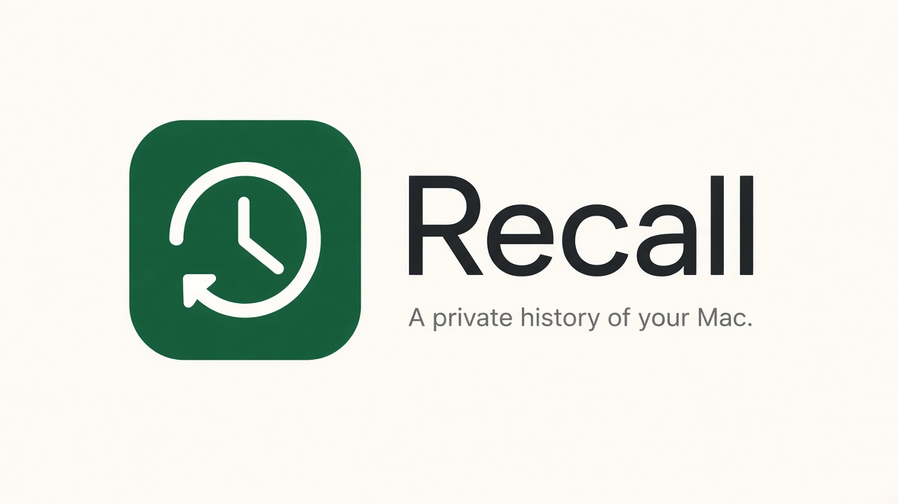

# Recall for macOS



**Website:** https://smugzombie.github.io/MacRecall/ · **Download:** [latest release](https://github.com/SmugZombie/MacRecall/releases/latest)

A native, local-first activity history for macOS. Recall captures the **focused window** at a regular interval, extracts text with Apple Vision, groups captures into work sessions, and makes everything searchable — by keyword out of the box, and with AI descriptions, summaries and semantic search when an AI provider is configured: [Ollama](https://ollama.com) or [LM Studio](https://lmstudio.ai) on your Mac, or OpenAI / Amazon Bedrock in the cloud.

Everything is stored under `~/Library/Application Support/RecallForMac/`, with history in a `Data.noindex` folder so Spotlight never indexes your screenshots or the text inside them. There is no telemetry, account or cloud sync; the only network traffic is to the AI provider you configure, and remote providers stay paused until you explicitly approve them.

## Build & run

Requirements: macOS 14+, Xcode 16+ (developed with Xcode 27).

```sh
open RecallForMac.xcodeproj          # then Run (⌘R)
# or
xcodebuild -project RecallForMac.xcodeproj -scheme RecallForMac build
```

Core logic tests (SwiftPM):

```sh
cd Packages/RecallCore && swift test
```

> **Signing:** the project signs ad hoc ("Sign to Run Locally"). macOS ties Screen Recording and Accessibility grants to the code signature, so with ad hoc signing you may need to re-grant permissions after rebuilding. Set your Development Team in the target's Signing settings to avoid this.

On first launch Recall shows a setup window for **Screen Recording** (required) and **Accessibility** (recommended, for exact focused-window identification). It lives in the menu bar; closing the window keeps recording. Toggle recording anywhere with **⌃⌥⌘P**.

### Optional: AI providers

Choose a provider in **Settings → AI**, then pick three models: **vision** (describes screenshots), **summary** (session titles, daily overviews, Q&A) and **embedding** (semantic search). With no vision model, the summary model analyzes recognized text only. Model choices are remembered per provider.

| Provider | Runs | Setup |
|---|---|---|
| Ollama | This Mac | `ollama pull qwen2.5vl`, `ollama pull llama3.2`, `ollama pull nomic-embed-text` |
| LM Studio | This Mac | Load models, then Developer tab → Start Server (default `http://127.0.0.1:1234/v1`) |
| OpenAI | Cloud | API key. The base URL can point at any OpenAI-compatible service |
| Apple Intelligence | This Mac | Nothing to install: macOS 26 on Apple silicon with Apple Intelligence turned on. Models are chosen for you |
| Amazon Bedrock | Cloud (your AWS account) | Region plus a Bedrock API key, IAM access keys, or an AWS CLI profile (SSO and other profile types are resolved with `aws configure export-credentials`) |

- API keys and AWS secrets are stored in the login keychain.
- **Remote destinations need approval.** Anything not on this Mac (OpenAI, Bedrock, or Ollama/LM Studio at a non-loopback address) gets no data until you approve that exact destination in Settings → AI. Changing the endpoint or Bedrock region requires a new approval. Cloud analysis is billed per request, and a screenshot every 30 s adds up.
- **Apple Intelligence** uses Apple's on-device model (Foundation Models) for summaries, titles and Ask, and Apple's NaturalLanguage embeddings for semantic search. It's private and free, but it has limits that Settings → AI lists when you choose it:
  - It can't read images, so screenshots are described from their recognized text and window title.
  - Its context is about 4,000 tokens; long prompts are shortened in the middle to fit.
  - It's a small model, so summaries are plainer than with larger models.
  - Its embeddings are weaker than dedicated embedding models and work best for Latin-alphabet languages.
  - Its safety guardrails can decline some content, which is then skipped.
- **Bedrock:** many current models must be invoked through an **inference profile ID** (e.g. `us.…` / `global.…`). Recall lists both on-demand models and inference profiles. JSON output is enforced with forced tool use, falling back to prompt instructions for models that don't support it. Embeddings support Amazon Titan Text Embeddings and Cohere Embed.
- Recall never downloads models itself.
- If the provider is offline or rejects credentials, AI jobs wait in the durable queue without using up retries. Capture, OCR, the timeline and keyword search keep working.

### Notes

Write a note from the menu bar ("Completed work on the importer", "Took lunch from 12 to 1"), press **⌘↩**, and it's saved with the current time. **⌃⌥⌘N** opens the New Note window from anywhere, where you can also attach files: choose them, drop them on the note, or paste a copied file or image. The paperclip in the menu bar opens the same window.

- Notes appear in the timeline between sessions, in the **Notes** list, in search (and as `[N<id>]` sources for Ask), and in daily summaries, where they also feed the AI overview.
- Attached files are copied into the library as they were when attached, and encrypted like screenshots (up to 100 MB each). **Open** decrypts a copy into a private temporary folder that Recall empties when it starts and quits; **Save As…** exports one.
- Retention never deletes notes. Delete them individually, or with **Delete All History**.

### Screenshot encryption

Screenshots and thumbnails are encrypted on disk with AES-GCM (CryptoKit), so other apps can't read them from `Application Support`. The key is created on first launch and kept in the login keychain, which hands it to Recall without asking and prompts for any other app. Each file is bound to its path in the library, and decrypted images only exist in memory. To give another app a copy, use **Export Screenshot…** in a screenshot's detail view.

- Screenshots from earlier versions are encrypted in the background after updating. Settings → Privacy → Screenshot encryption shows progress.
- **Keep a recovery key.** If the keychain item is lost (a reset keychain, or a new Mac without it), screenshots can't be opened. **Export Recovery Key…** saves the key to a file; anyone with that file and a copy of the library can view the screenshots, so store it privately. **Import Recovery Key…** unlocks them again. New captures keep working without the old key.
- If the keychain can't be read (for example, it's locked), captures fail rather than being saved unencrypted.
- Builds signed with a different identity (for example, Xcode debug builds vs. releases) cause a one-time keychain prompt.

The design and its limits are in [design/screenshot-encryption.md](design/screenshot-encryption.md).

### AI agents (MCP)

Recall can serve your history to an AI agent (Claude Code, Claude Desktop, Cursor or any other [MCP](https://modelcontextprotocol.io) client), so you can ask things like "what was I working on Tuesday afternoon?", "how long did I spend in Slack this week?" or "find the error I saw in the terminal yesterday".

1. Turn on **Settings → Privacy → AI agent access (MCP)**. It's off by default, and turning it off blocks agents immediately.
2. Add Recall to your agent. Settings shows the exact command for your install:

   ```sh
   claude mcp add --scope user recall -- "/Applications/RecallForMac.app/Contents/MacOS/RecallForMac" --mcp
   ```

   For other clients, **Copy JSON Configuration** gives the usual `mcpServers` entry (command: the app binary, args: `--mcp`).

The agent starts the app binary with `--mcp`. That process only opens the library read-only and speaks MCP over stdin/stdout. It doesn't start the UI or capture anything, and it makes no network requests. It works whether or not Recall is running.

| Tool | What it returns |
|---|---|
| `search_history` | Keyword search over on-screen text, window titles, apps, AI descriptions, sessions and notes, with date (`from`/`to` or `when: "yesterday morning"`), app and project filters |
| `get_capture` | One capture's time, app, window, project, session, AI description and full recognized text |
| `get_screenshot` | A capture's screenshot as an image (full size up to 2560 px, or the thumbnail), only if you've allowed it |
| `get_session` | A session's title, summary, active time, apps and captures |
| `list_sessions` | Sessions in a time range (default today) |
| `usage_report` | Active time by app, project, window or day |
| `daily_summary` | The day's notes, time, projects, apps, sessions and errors seen on screen |
| `list_projects` | Projects with aliases, repositories and recent time |
| `list_notes` | Your notes in a time range (default the last 7 days), optionally matching a query or project |
| `get_note` | One note's full text, time, project and attachment names; attachment contents aren't shared |

- **Screenshots need a second opt-in.** Agents get text only until you also turn on **Allow agents to view screenshots**, which is off by default. Images can show more than the redacted text, such as photos, other people's messages and anything OCR missed. The `--mcp` process decrypts screenshots in memory with the same keychain key as the app.
- Whatever the agent reads goes to its model, so it leaves your Mac if the agent uses a cloud model. Redaction applies to both, because sensitive text is removed (and blacked out in screenshots) before anything is stored.
- Search is keyword-only and doesn't call your embedding provider. The agent does the reasoning itself.
- Settings shows which client last read the history, and when.

### Updates

Recall checks GitHub Releases for this repository once a day (and from **Check for Updates…** in the app menu or Settings → General). When a newer version is out, it shows the release notes and can install it in place:

1. Download the release's `RecallForMac-<version>.zip`.
2. Check it against the SHA-256 digest GitHub publishes for the asset.
3. Unpack it and confirm it's the same app and the advertised, newer version.
4. Verify its code signature against the running app's own Team ID and bundle identifier (`anchor apple generic and identifier … and certificate leaf[subject.OU] = <team>`). A build signed by anyone else is refused.
5. Swap the bundle and relaunch.

Self-update is disabled for development builds (DerivedData), unsigned or ad hoc builds, and install locations Recall can't write to. Those get a download link instead. Automatic checks can be turned off in Settings → General → Updates. A GitHub token there is only needed if you build from a private fork.

## Architecture

```
RecallForMac.xcodeproj
RecallForMac/                 SwiftUI app target (thin)
  App/                        RecallApp (MenuBarExtra + windows), AppState, global hot key
  UI/                         Timeline, Search, Notes, Projects, Summaries, Queue, Settings, Onboarding
Packages/RecallCore/          All logic, unit-tested with `swift test`
  Database/                   SQLite wrapper (WAL, FKs), migrations, FTS5 triggers, repositories
  Capture/                    ActiveWindowResolver, ScreenshotService (ScreenCaptureKit),
                              CaptureCoordinator, image encoding + perceptual dedupe
  Monitoring/                 App activation, lock/unlock, sleep/wake, idle, battery, secure input
  OCR/                        Apple Vision text recognition
  AI/                         AIProvider protocol; Ollama, OpenAI-compatible (OpenAI, LM Studio), Bedrock
                              (Converse + SigV4, no AWS SDK) and Apple Intelligence (Foundation Models +
                              NaturalLanguage) providers; output validation; job queue
  Activity/                   Deterministic SessionBuilder, ProjectClassifier, ProjectSuggester, daily summaries
  Search/                     Query interpretation, FTS5 search, vector index, hybrid RRF, grounded Q&A
  Privacy/                    CapturePolicy, sensitive-content redaction, retention
  Updates/                    GitHub release client, semantic versions, verified in-place installer
  MCP/                        Stdio MCP server (JSON-RPC) and read-only history tools for `--mcp`
```

### Capture pipeline

1. **Policy first.** `CapturePolicy` checks pause state, lock/sleep, idle, battery, exclusions and secure keyboard input *before* any pixels are read.
2. **Focused window.** `ActiveWindowResolver` reads the focused window through Accessibility and matches it to an `SCWindow` by frame and title. Without Accessibility it uses the frontmost on-screen window of the active process (CGWindowList z-order). If no window can be identified the capture is skipped and the reason logged — it never falls back to a full-display screenshot.
3. **Capture.** `SCScreenshotManager` with a `desktopIndependentWindow` filter; ScreenCaptureKit downsizes to the configured maximum.
4. **Dedupe.** A 64-bit dHash *plus* a 32×32 luminance grid. dHash alone misses small text changes (a new terminal line); the grid catches them. Unchanged frames extend the previous capture's `last_seen_at` instead of storing a new file.
5. **Redaction (if enabled).** OCR runs inline; lines matching sensitive-content rules are blacked out in the image and replaced in the text *before* anything is written.
6. **Persist** atomically (temp file + rename), then enqueue OCR / analysis / embedding jobs.

### Durable job queue

Jobs live in the `ai_jobs` table with a partial unique index so a pending/running job can't be queued twice. Workers claim by priority then recency (new and user-requested work jumps the backlog). Transient failures (5xx, throttling) back off exponentially up to 5 attempts; a provider outage or rejected credentials return the job to the queue without spending an attempt. Jobs left `running` by a crash are recovered at startup.

### Sessions

`SessionBuilder` is deterministic and LLM-free: idle/lock/sleep interruptions and gaps split sessions; differing projects never share one; a *sustained* vocabulary change (two consecutive off-topic captures) starts a new session, while a single glance at chat or mail does not. AI results later add titles and summaries but never override a user's edits.

### Search

`HybridSearch` interprets dates ("before lunch yesterday", "last Tuesday") and app references ("terminal", "browser") into filters, runs FTS5 (BM25) and vector similarity, and fuses them with reciprocal-rank fusion. User input never reaches FTS5 raw: every term is quoted. "Ask" answers come from the summary model using only retrieved records; each claim must cite `[C<id>]`/`[S<id>]`/`[N<id>]`, citations to records that were not supplied are stripped, and an answer without valid citations is reported as insufficient evidence.

## Status against the spec

| Phase | State |
|---|---|
| 1 Foundation | Done — menu bar, main window, settings persistence, onboarding, launch at login |
| 2 Capture | Done — needs manual validation on multi-monitor/Spaces setups |
| 3 Timeline & persistence | Done — sessions list, lazy thumbnails, scrubber, detail inspector, retention |
| 4 OCR & keyword search | Done |
| 5 AI providers | Done — Ollama, LM Studio, OpenAI, Bedrock; model discovery, structured output, durable queue |
| 6 Sessions & summaries | Done — merge/split/rename/reassign, daily Markdown summaries |
| 7 Natural-language search | Done — hybrid retrieval, date interpretation, cited answers |
| 8 Release | Partial — see below |

### Known gaps

- **Only screenshots are encrypted.** Screenshots and thumbnails are encrypted at rest (see [Screenshot encryption](#screenshot-encryption)), but the database — recognized text, AI descriptions, window titles, summaries — is plain SQLite and relies on FileVault. SQLCipher is the planned next step ([TODO.md](TODO.md)).
- **Vector search** is an exact streaming scan behind a `VectorIndex` protocol — fine for a single user's history (especially time-filtered), replaceable with sqlite-vec/HNSW later.
- **Notifications** and configurable hot keys are not implemented (they're fixed to ⌃⌥⌘P and ⌃⌥⌘N).
- **Notes are keyword-searched only**; they aren't embedded for semantic search.
- **Cloud providers are tested against recorded request/response shapes and the AWS SigV4 test vectors, not live accounts.** Verify with your own OpenAI key / AWS account.
- With ad hoc signing, macOS may ask again for keychain access after each rebuild.
- **Notarization**: releases from 1.1.6 are signed with a Developer ID, notarized and stapled. Builds you make yourself aren't, so macOS may ask before opening them.
- Project suggestions are rule-based: names the AI saw on screen plus repository folders (`~/Github/<name>`, `~/src/<name>`, …) that recur in unassigned activity. Different names for one project (e.g. an app and its repo) appear as separate suggestions.
- On macOS 15+, the OS periodically re-asks the user to confirm continued screen recording for apps using ScreenCaptureKit. That is system behavior and can't be suppressed.
